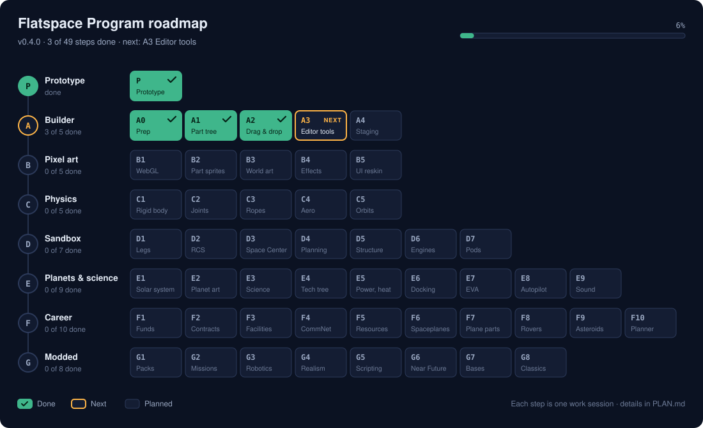

# Flatspace Program

A 2D rocket-building and spaceflight game that runs in your browser, inspired by Kerbal Space Program.

**[Play it here](https://rabidkoala25.github.io/FlatSpace/)**

You build a rocket out of parts, launch it from the planet Aster and try to get it into orbit. From there you can head out to the two moons, Mira and Pell. The orbits are real: you plan burns with maneuver nodes, watch for encounters in the map view, and use time warp to skip the long coasts.

It's still early. The building and flying work, and there's a lot more on the way: pixel art, better physics, more planets, science, a career mode, astronauts you can walk around with, and plenty that KSP doesn't have.

## Your first orbit

1. In the hangar, pick **Orbiter I** from the "Load craft…" menu (or build your own) and press **Launch**.
2. Press **Space** to light the engine. Once you're past about 1 km, hold **D** to tip over towards the east, aiming for roughly 45° by the time you reach 12 km.
3. When the first stage runs out, press **Space** again to drop it and light the upper stage.
4. Keep an eye on your apoapsis (in the flight data, or the map with **M**). Cut the engine with **X** when it gets to about 80 km.
5. Coast up to apoapsis, point prograde with the **Pro** button and burn until your periapsis is above 70 km. That's orbit.
6. Now open the map, click your orbit to add a maneuver node, and see if you can get to Mira.

## Building a rocket

Drag parts from the tray on the left into the build area. They snap together end to end, and side parts like boosters and fins stick to the sides of tanks (on a sloped part like a capsule, they lean to match it). If a part turns red, it can't go there.

Drop a part in empty space and it just floats there. Floating parts are left behind when you launch, unless you open their settings and pick **Launch with the craft**, in which case they appear next to your rocket on the pad, exactly where you put them. Drag one back onto the rocket to attach it again.

| Input | What it does |
|---|---|
| Drag from the tray | Add a part |
| Click or tap a part in the tray | Add it to the bottom of the rocket |
| Drag a placed part (on touch, hold then drag) | Move it, along with everything below it |
| Drop it back on the tray, or press Delete | Remove it |
| Mouse wheel, or drag empty space | Zoom and pan |
| Two fingers | Pan and pinch to zoom |
| Home, or the Fit button | Show the whole rocket |
| X | Mirror mode: side parts come in pairs |
| Q / E (hold Shift for small steps) | Rotate a part |
| F | Flip a part |
| Alt-drag (on touch, the Offset button) | Slide a side part up or down |
| Alt-click (on touch, the Copy button) | Copy a part and everything attached below it |
| Ctrl+Z / Ctrl+Y | Undo / redo |

Everything also has a button on the toolbar down the left side, so it all works on a phone.

Clicking a part opens a little settings pop-up next to it, with a line pointing back at the part. Clicking another part swaps it for that part's pop-up, unless you pin it with 📌, so you can keep a few open at once. Drag a pop-up by its title to move it out of the way.

Fuel tanks stretch: select one and drag the handle at its end, or use its pop-up to set its length, width, look and how much fuel it starts with. Other parts have settings too, like an engine's thrust limit or how high a parachute opens.

The stage list on the right works things out for you, but you can change it: drag the parts between stages, move stages up and down, or leave a part out. **Files** lets you download a craft, open one, or copy it as a line of text to send to someone.

The switches in the top corner show where your rocket's centre of mass (yellow), thrust (pink) and pressure (blue) are. If the blue one is above the yellow one, the air will try to flip your rocket over. Fins near the bottom fix that.

## Flying

| Key | What it does |
|---|---|
| Space | Next stage |
| Shift / Ctrl | Throttle up / down |
| Z / X | Full throttle / cut engine |
| A / D or ← / → | Turn |
| T | SAS on or off |
| M | Map |
| . / , | Speed time warp up / down |
| / | Stop time warp |
| P | Open parachutes |
| Tab | Switch what the map is centred on |
| H | Show the controls |
| Esc | Menu (revert the flight, go back to the hangar) |

Click or tap a part of your rocket in flight to open its pop-up. You can change an engine's thrust limit, shut it down or restart it, fire a decoupler, turn crossfeed on or off, or arm a parachute without staging everything else.

## Pixel size

Everything is drawn as pixel art, and the pixels stay the same size across the whole screen as you zoom. If you'd like bigger, chunkier pixels, open the menu (Esc) and pick **Fine**, **Medium** or **Chunky**.

The game needs a browser with WebGL2, which is almost every browser from the last few years. On one without it, the game still runs with simpler drawing and tells you so. `art.html` shows every colour and sprite in the game, turning slowly.

## Running it yourself

It's just HTML, CSS and JavaScript with nothing to install. Download the folder and open `index.html`. If your browser won't run it from a file, start a local server in the folder (for example `python3 -m http.server`) and open `http://localhost:8000`.

To run the tests, use `npm install` then `node tests/run.js`. The WebGL test also needs Playwright (`npm install playwright` and `npx playwright install chromium`); without it, that test is skipped.
