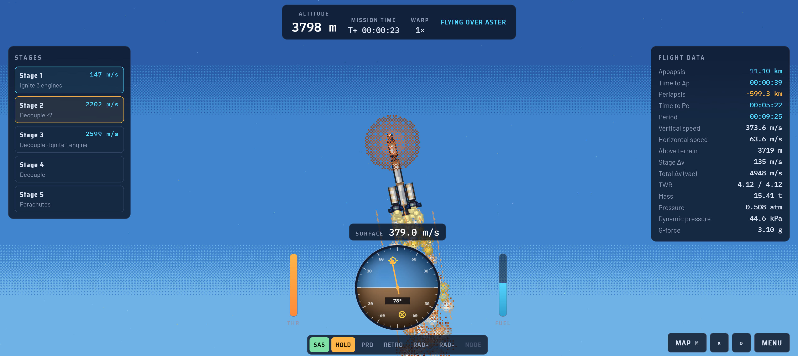

# Flatspace Program

A 2D rocket-building and spaceflight game, inspired by Kerbal Space Program.

**[Play it here](https://rabidkoala25.github.io/FlatSpace/)**

## About

### Hello! welcome to flatspace
What is flatspace?

- 2d spaceflight simulator!
- ambitious plan for the future, planning to match and go beyond both spaceflight simulator AND KSP!
- lots of room for expansion!
- home grown pixel art!

## Features
### Working now
- Drag-and-drop rocket building
- Mirror, rotate, offset and undo
- Stretchable fuel tanks
- Part settings and staging editor
- Save and load crafts
- Pixel-art renderer
- Orbits, map view and maneuver nodes
- Landed rockets can tip over

### Planned
- Hand-drawn sprites (in progress)
- Better physics: joints, parachutes, aero
- Planes and rovers
- Realistic terrain
- Tech tree and contracts
- Rocket competition mode
- Walkable interiors and astronauts
- Weather and clouds

## First flight
1. Load Orbiter I in the hangar and press Launch.
2. Press Space to ignite.
3. Hold D after 1 km to tip east. Aim for 45° by 12 km.
4. Press Space to drop the empty stage.
5. Cut the throttle (X) when apoapsis hits 80 km.
6. At apoapsis, point prograde (forwards for the noobs) and burn until periapsis is above 70 km.
7. You reached orbit! Yipeee!

## Controls
| Key | Action |
|---|---|
| Space | Next stage |
| Shift / Ctrl | Throttle up / down |
| Z / X | Full throttle / cut engine |
| A / D or <- / -> | Turn |
| T | SAS on/off |
| M | Map |
| . / , | Time warp faster / slower |
| / | Stop time warp |
| P | Parachutes |
| Tab | Change map focus |
| H | Show controls |
| Esc | Menu |

## Running it locally
No install needed.
1. Download or clone the repo.
2. Open `index.html`.
3. If that doesn't work, run `python3 -m http.server` in the folder and open `http://localhost:8000`.
4. Run the tests with `node tests/run.js`.

## Project structure
| Place | contents |
|---|---|
| [`index.html`](index.html) | The game page |
| [`js/`](js/) | Game code |
| [`css/`](css/) | Styles |
| [`art/`](art/) | Pixel-art sprites |
| [`data/`](data/) | Parts and craft data |
| [`docs/`](docs/) | Roadmap and screenshots |
| [`tests/`](tests/) | Automated tests |
| [`tools/`](tools/) | Helper scripts |
| [`PLAN.md`](PLAN.md) | Full design and roadmap |
| [`PARTS.md`](PARTS.md) | Every planned part |

## Roadmap

## Credits
- Inspired by Kerbal Space Program and Spaceflight Simulator.
- Made for Hack Club Terra.